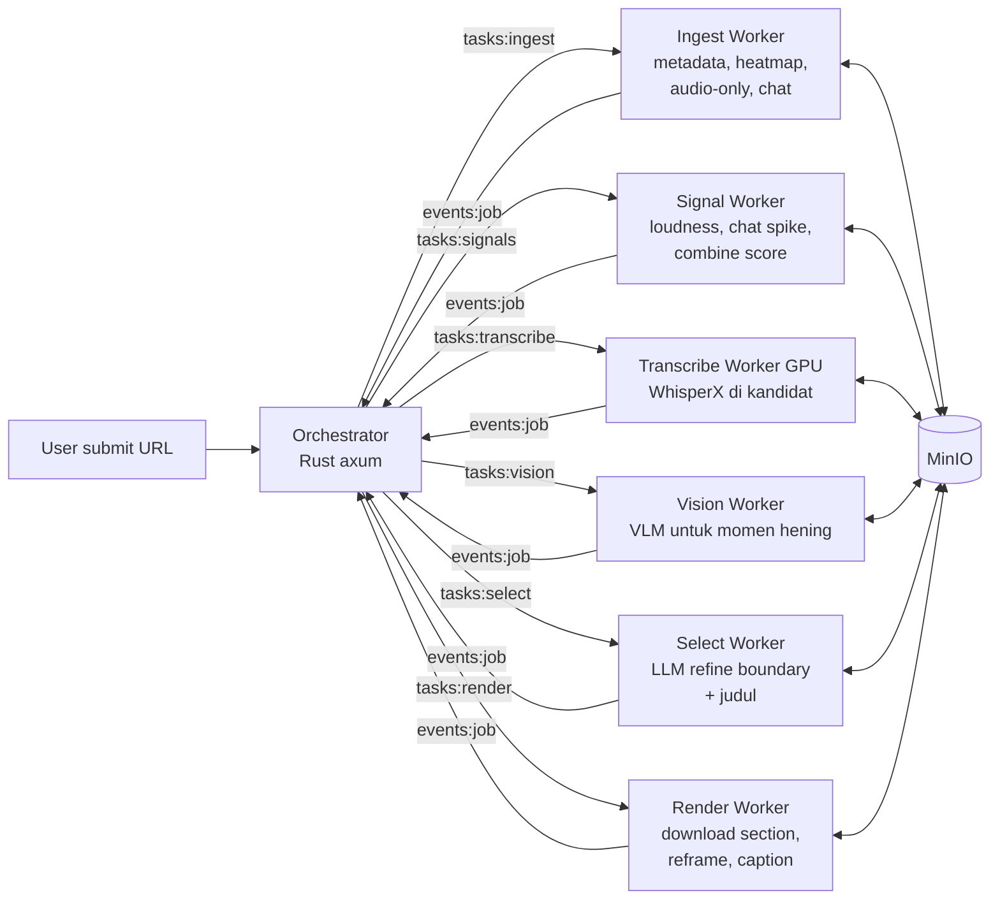
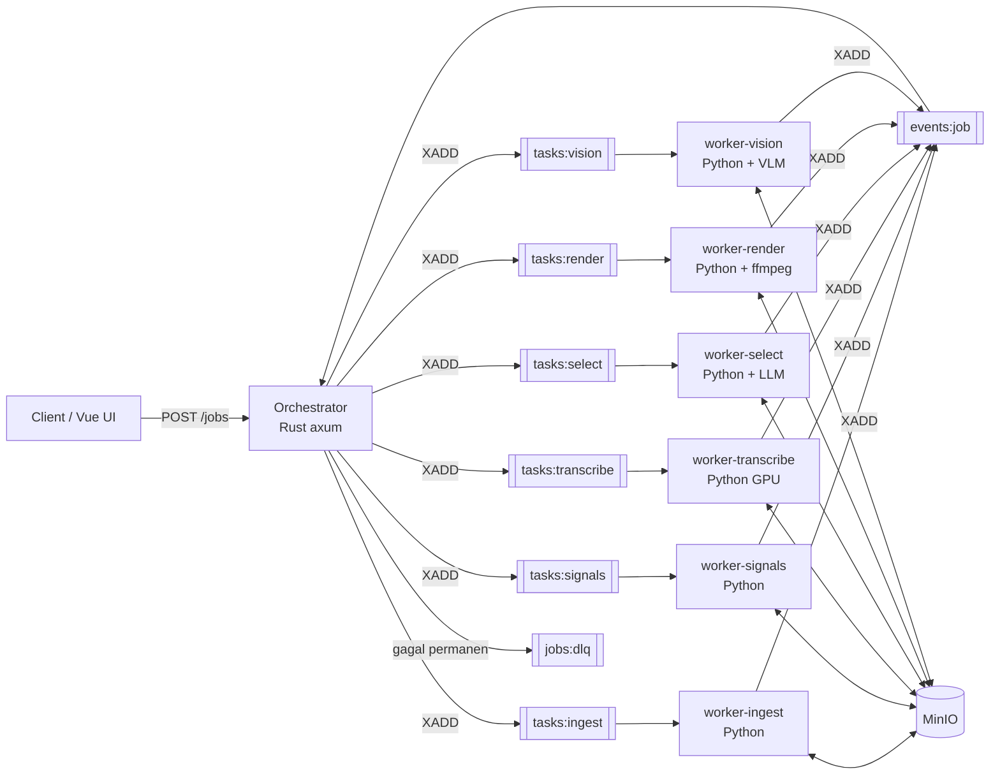
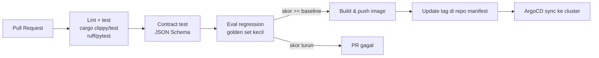

# AI Auto-Clipper — Project Design Doc

> Sistem yang menerima **link video** (YouTube / Twitch VOD), lalu otomatis menemukan momen paling menarik, memotongnya jadi clip vertikal 9:16 (layout facecam + gameplay ala clipper streamer), menambahkan caption kata-per-kata, dan mengekspor clip siap upload.
>
> Sekaligus jadi project latihan **AI DevOps / MLOps**: pipeline multi-tahap, GPU worker, job queue, autoscaling, eval, dan model registry.
>
> **Stack:** Python untuk ML & media (Phase 1–2: satu script), lalu di Phase 3 **orchestrator Rust (axum) + worker Python** yang terhubung lewat **Redis Streams**.

---

## Daftar Isi

1. [Problem yang mau diselesaikan](#1-problem-yang-mau-diselesaikan)
2. [Apakah ini beneran possible?](#2-apakah-ini-beneran-possible)
3. [Tech stack & keputusan bahasa](#3-tech-stack--keputusan-bahasa)
4. [Gambaran arsitektur](#4-gambaran-arsitektur)
5. [Pipeline detail per tahap](#5-pipeline-detail-per-tahap)
6. [Algoritma highlight scoring](#6-algoritma-highlight-scoring)
7. [Momen tanpa suara & YouTube Analytics](#7-momen-tanpa-suara--youtube-analytics)
8. [V2: train model highlight ranker sendiri](#8-v2-train-model-highlight-ranker-sendiri)
9. [Evaluasi](#9-evaluasi)
10. [Arsitektur AI DevOps / MLOps](#10-arsitektur-ai-devops--mlops)
11. [Struktur repo](#11-struktur-repo)
12. [Roadmap & milestone](#12-roadmap--milestone)
13. [Risiko & mitigasi](#13-risiko--mitigasi)
14. [Catatan legal & etika](#14-catatan-legal--etika)
15. [Referensi tools](#15-referensi-tools)

---

## 1. Problem yang mau diselesaikan

### Apa yang dikerjakan clipper manusia

| Langkah | Yang dilakukan manusia | Susah diotomasi? |
|---|---|---|
| 1 | Nonton VOD 3–6 jam | Mahal waktu, tapi mesin bisa "nonton" cepat |
| 2 | **Nyari momen yang "pecah"** (teriak, rage, lucu, plot twist) | **Paling susah**, butuh "selera" |
| 3 | Nentuin batas potongan: mulai sebelum momen, selesai setelah punchline | Sedang |
| 4 | Crop 16:9 → 9:16, facecam atas + gameplay bawah | Mudah–sedang |
| 5 | Caption kata-per-kata yang nge-pop | Mudah (kalau ada transkrip) |
| 6 | Judul / hook | Mudah (LLM) |

**Analogi:** VOD 5 jam itu pasir, momen viral itu emas. AI clipper adalah **mesin dulang**. Yang susah bukan bagian motong (itu ffmpeg), tapi **tahu di mana emasnya**.

### Constraint teknis utama

- **Input cuma link**, jadi harus bisa ambil video, audio, dan sinyal penonton dari URL.
- **Video panjang itu berat.** Download full VOD 5 jam 1080p itu puluhan GB. Harus hemat.
- **GPU mahal.** Transkripsi 5 jam full itu boros. Harus selektif.
- **"Menarik" itu subjektif**, jadi butuh sinyal dari manusia (penonton) plus evaluasi yang jelas.

---

## 2. Apakah ini beneran possible?

**Jawaban singkat: YA.** Produk komersial sejenis sudah ada (misalnya Opus Clip, Klap, Vizard, Eklipse untuk gaming stream, StreamLadder untuk layout vertikal streamer). Semua komponennya juga sudah tersedia sebagai tools open-source:

| Komponen | Tool | Status |
|---|---|---|
| Ambil video/audio dari link | `yt-dlp` | Matang, support ratusan situs |
| Sinyal penonton YouTube | Heatmap "Most Replayed" (diambil via `yt-dlp`) | Ada, tapi **tidak di semua video** |
| Sinyal penonton Twitch | Chat replay (`chat-downloader`, `tcd`) + Twitch Clips API | Ada |
| Transkrip + timestamp per kata | `WhisperX` / `faster-whisper` | Matang, support Bahasa Indonesia |
| Deteksi wajah / facecam | OpenCV YuNet, MediaPipe | Matang |
| Potong, crop, caption | `ffmpeg` + subtitle `.ass` (libass) | Matang |
| Penilaian semantik / judul | LLM (API atau lokal via Ollama) | Matang |

### Tapi jujur, bagian yang susah

1. **Kualitas pemilihan momen.** MVP yang hasilnya "lumayan" itu gampang. Yang hasilnya **setara clipper manusia** itu susah. Di situ letak 80% effort-nya.
2. **Sinyal penonton tidak selalu ada.** Heatmap YouTube butuh views yang cukup banyak dan tidak muncul di semua video. Heatmap juga **kasar**: biasanya ~100 titik untuk seluruh video, jadi di VOD 3 jam satu titik ≈ 1–2 menit.
3. **"Watch time" asli tidak bisa diakses.** Data watch time / retention cuma bisa dilihat pemilik channel (YouTube Analytics). Yang publik cuma heatmap sebagai proxy.
4. **Akses platform.** yt-dlp dari IP server/datacenter sering kena verifikasi "bukan bot" dari YouTube. VOD Twitch juga punya masa kedaluwarsa.
5. **Biaya GPU** kalau mau di-scale.

**Kesimpulan:** Sangat possible dan realistis sebagai project portfolio. MVP lokal bisa jadi dalam 1–2 minggu part-time. Bagian yang bikin project ini "berkelas" adalah scoring, eval, dan infra-nya.

> ✅ Potongan kode di dokumen ini (scoring, deteksi facecam, caption ASS, render 9:16) **sudah dites jalan** pada video sintetis. Orchestrator Rust + base worker Python (Bagian 10) juga sudah dikompilasi dan dites end-to-end (alur normal, retry, DLQ). Kode momen hening (Bagian 7: retensi, quiet anomaly, motion, grid VLM, scene snap, caption konteks) juga sudah dites dengan data sintetis. Bagian yang butuh akses internet ke YouTube/Twitch (yt-dlp, chat-downloader) dan GPU (WhisperX) belum dites end-to-end, jadi tes di mesin kamu.

---

## 3. Tech stack & keputusan bahasa

### 3.1 Masalahnya dulu: lambatnya di mana?

Sebelum milih bahasa "yang cepat", cek dulu waktu sebenarnya habis di mana:

| Tahap | Yang makan waktu | Kerja beratnya dilakukan oleh | Ditulis ulang di Rust bikin lebih cepat? |
|---|---|---|---|
| Download | Jaringan | Server YouTube/Twitch | ❌ |
| Sinyal (loudness, z-score, peak) | Hitungan array | numpy/scipy (C/Fortran) | ❌ hampir tidak |
| Transkrip | Inferensi model | GPU (CUDA, CTranslate2 C++) | ❌ |
| LLM | Nunggu respons | Server LLM | ❌ |
| Render | Encode video | ffmpeg (C) | ❌ |
| **Orkestrasi job, API, banyak koneksi** | Concurrency, memori | Bahasa aplikasinya sendiri | ✅ **di sini Rust menang** |

**Analogi:** pesanan di restoran lama karena oven (GPU/ffmpeg) dan supplier (download), bukan karena langkah kaki pelayan. Ganti pelayan jadi pelari Olimpiade (Rust) tidak bikin oven lebih cepat. Tapi **kepala dapur** yang mengatur ratusan pesanan sekaligus memang enak kalau gesit dan hemat tenaga. Peran itu cocok untuk Rust.

**Tuas kecepatan yang benar-benar berpengaruh:**
1. **Coarse-to-fine**: transkrip hanya di kandidat (dampak paling besar)
2. **faster-whisper + batching** di GPU
3. **Download section** saja, bukan full video
4. **NVENC** (`h264_nvenc`) untuk encode kalau ada GPU NVIDIA
5. **Paralel antar worker** (K8s + KEDA)

### 3.2 Keputusan

| Keputusan | Pilihan | Alasan |
|---|---|---|
| Phase 0–2 (MVP & kualitas) | **Satu script Python**, tanpa queue | Fokus ke kualitas clip dulu, bukan infra |
| Worker ML & media | **Python** | Ekosistem: WhisperX, YAMNet, OpenCV, LightGBM, MLflow |
| API + orchestrator (Phase 3) | **Rust** (axum + tokio) | Konkurensi tinggi, memori kecil, state machine yang type-safe |
| Penghubung antar bahasa | **Redis Streams** + kontrak **JSON Schema** | Lintas bahasa. Celery tidak dipakai karena hanya untuk Python |
| Job state | Redis hash (skeleton) → **Postgres** via `sqlx` | Mulai simpel, lalu durable |

### 3.3 Stack lengkap per layer

| Layer | Tool | Bahasa | Mulai di Phase |
|---|---|---|---|
| Ingest | `yt-dlp` | Python | 1 |
| Chat & clips | `chat-downloader`, Twitch Helix API (`httpx`) | Python | 1 |
| Sinyal | `numpy`, `scipy`, `ffmpeg` | Python | 1 |
| Transkrip | `faster-whisper` / `whisperx` | Python (GPU) | 1 |
| Face detection | OpenCV `FaceDetectorYN` (YuNet) | Python | 1 |
| Caption | Subtitle `.ass` + libass | Python | 1 |
| Render | `ffmpeg` (`libx264` / `h264_nvenc`) | — | 1 |
| Audio event | YAMNet / PANNs | Python | 2 |
| LLM | API (Claude/OpenAI/Gemini) atau Ollama, validasi `pydantic` | Python | 2 |
| Eval | `pandas`, script precision@k / NDCG | Python | 2 |
| Retensi (channel sendiri) | YouTube Analytics API v2 (`google-api-python-client`, OAuth), `scikit-learn` (isotonic) | Python | 2 |
| Sinyal visual | OpenCV (motion facecam/gameplay), PySceneDetect | Python | 2 |
| VLM (momen hening) | API vision (Claude/GPT/Gemini) atau lokal (Qwen-VL) | Python | 2 |
| **Orchestrator & API** | `axum`, `tokio`, `redis` (redis-rs), `serde`, `uuid`, `tracing` | **Rust** | 3 |
| Message bus | **Redis 7 Streams** (consumer group) | — | 3 |
| Kontrak message | JSON Schema → `serde` (Rust) + `pydantic` (Python) | Rust + Python | 3 |
| Job state & history | Redis hash → Postgres (`sqlx`) | Rust | 3 |
| Object storage | MinIO (S3 API): `aws-sdk-s3` / `object_store` (Rust), `boto3` (Python) | — | 3 |
| Frontend (opsional) | Vue + Vite: submit link, preview & keep/hapus clip | TypeScript | 3 |
| Container | Docker: `cargo-chef` + distroless (Rust), CUDA base (worker GPU) | — | 3 |
| Infra | Kubernetes (Proxmox), KEDA, ArgoCD, NVIDIA device plugin | — | 3 |
| Observability | Prometheus (`metrics-exporter-prometheus` / `prometheus_client`), Grafana, Loki, OpenTelemetry, Langfuse | — | 3 |
| CI/CD | GitHub Actions | — | 3 |
| ML lifecycle | MLflow, DVC, LightGBM | Python | 4 |
| Retrain terjadwal | Prefect / Airflow | Python | 4 |

### 3.4 Kenapa tidak full Rust?

| Komponen | Opsi di Rust | Trade-off |
|---|---|---|
| Transkrip | `whisper-rs` (whisper.cpp), `candle` | Timestamp per kata kurang presisi dibanding forced alignment WhisperX → caption meleset |
| Audio classifier | `ort` (ONNX Runtime) | Bisa, tapi harus export & maintain model ONNX sendiri |
| Face detection | `ort` + YuNet ONNX | Bisa, effort ekstra tanpa keuntungan berarti |
| Training ranker | — | Tetap harus Python (LightGBM, MLflow, pandas) |
| ffmpeg | spawn process | Sama saja dengan Python |

**Kesimpulan:** Rust dipakai di tempat ia unggul (orchestrator), Python di tempat ekosistemnya unggul (ML). Kalau suatu saat mau versi **desktop app / single binary**, Opsi full Rust (atau Tauri sebagai shell + sidecar Python) bisa dipertimbangkan belakangan.

---

## 4. Gambaran arsitektur

### Ide kunci: **coarse-to-fine** (kasar dulu, baru detail)

Jangan proses semua hal di seluruh video. Pakai sinyal **murah** dulu untuk seluruh video, lalu proses yang **mahal** hanya di area kandidat.

```
Seluruh video (murah)              Kandidat saja (mahal)              Final (paling mahal)
────────────────────              ─────────────────────              ────────────────────
metadata + heatmap        ──►     transkrip WhisperX (GPU)    ──►    download potongan video
audio-only → loudness             LLM menilai & menentukan            reframe 9:16
chat replay → chat spike          batas potongan                      caption + render
```

Analogi: kayak nyari kunci yang hilang. Kamu nggak bongkar seluruh rumah. Pertama tanya "terakhir di mana?" (sinyal penonton), baru bongkar ruangan itu secara detail.

### Diagram



> Di Phase 1–2 semua tahap ini cukup jadi **fungsi berurutan dalam satu script Python** (`pipeline.py`). Pemecahan jadi orchestrator + worker baru dilakukan di Phase 3 (Bagian 10).

---

## 5. Pipeline detail per tahap

### Tahap 1 — Ingest dari link

Prinsip: **jangan download video dulu.** Ambil metadata + audio-only dulu.

```python
# ingest.py
import yt_dlp
from yt_dlp.utils import download_range_func


def fetch_metadata(url: str) -> dict:
    with yt_dlp.YoutubeDL({"quiet": True, "skip_download": True}) as ydl:
        info = ydl.extract_info(url, download=False)
    return {
        "id": info["id"],
        "title": info.get("title"),
        "duration": info.get("duration"),
        "extractor": info.get("extractor_key"),     # "Youtube", "TwitchVod", ...
        "heatmap": info.get("heatmap") or [],       # [{start_time, end_time, value}] atau kosong
    }


def download_audio(url: str, out_dir: str) -> str:
    opts = {"format": "bestaudio/best", "outtmpl": f"{out_dir}/%(id)s.%(ext)s", "quiet": True}
    with yt_dlp.YoutubeDL(opts) as ydl:
        info = ydl.extract_info(url, download=True)
        return ydl.prepare_filename(info)


def download_section(url: str, start: float, end: float, out_tmpl: str):
    """Download HANYA potongan [start, end] detik dalam kualitas video."""
    opts = {
        "format": "bv*[height<=1080]+ba/b[height<=1080]",
        "outtmpl": out_tmpl,                         # misal "work/clip_01.%(ext)s"
        "download_ranges": download_range_func(None, [(start, end)]),
        "force_keyframes_at_cuts": True,             # potongan presisi (re-encode di titik potong)
        "merge_output_format": "mp4",
        "quiet": True,
    }
    with yt_dlp.YoutubeDL(opts) as ydl:
        ydl.download([url])
```

Penghematan: dari VOD 5 jam, yang di-download dalam kualitas video cuma total beberapa menit.

**Twitch chat replay:**

```python
# signals_chat.py
import numpy as np
from chat_downloader import ChatDownloader   # pip install chat-downloader

HYPE = {"KEKW", "OMEGALUL", "LUL", "LMAO", "W", "POG", "POGGERS", "PogChamp", "ICANT", "LOL"}


def chat_signal(url: str, duration: float) -> np.ndarray:
    counts = np.zeros(int(duration) + 1)
    for msg in ChatDownloader().get_chat(url):
        t = msg.get("time_in_seconds")
        if t is None or not (0 <= t <= duration):
            continue
        tokens = set(msg.get("message", "").split())
        counts[int(t)] += 1 + 2 * len(tokens & HYPE)   # pesan hype dapat bobot ekstra
    return counts
```

### Tahap 2 — Sinyal murah (seluruh video)

```python
# signals.py
import subprocess
import numpy as np


def heatmap_per_second(heatmap, duration):
    arr = np.zeros(int(duration) + 1)
    for h in heatmap:
        arr[int(h["start_time"]):int(h["end_time"]) + 1] = h["value"]
    return arr


def loudness_per_second(audio_path, sr=16000):
    """RMS (dB) per detik. Streaming lewat ffmpeg pipe, jadi hemat RAM untuk VOD berjam-jam."""
    cmd = ["ffmpeg", "-v", "quiet", "-i", audio_path, "-ac", "1", "-ar", str(sr), "-f", "s16le", "-"]
    proc = subprocess.Popen(cmd, stdout=subprocess.PIPE)
    out = []
    while True:
        buf = proc.stdout.read(sr * 2)              # 1 detik audio int16
        if not buf:
            break
        x = np.frombuffer(buf, dtype=np.int16).astype(np.float32) / 32768
        out.append(20 * np.log10(np.sqrt(np.mean(x ** 2) + 1e-12) + 1e-9))
    proc.wait()
    return np.array(out)
```

Sinyal tambahan yang bisa ditambah belakangan: **deteksi tawa/teriakan** pakai audio classifier (YAMNet / PANNs). Ini lebih akurat daripada sekadar loudness, karena musik keras juga bikin loudness tinggi.

### Tahap 3 — Gabungkan sinyal → kandidat momen

Lihat [Bagian 6](#6-algoritma-highlight-scoring) untuk detailnya. Output-nya: **top-N timestamp puncak** (misalnya 10–15 kandidat).

### Tahap 4 — Transkrip HANYA di kandidat (GPU)

Potong audio ±90 detik di sekitar setiap kandidat, lalu transkrip pakai WhisperX untuk dapat **timestamp per kata**.

```python
# transcribe.py
import subprocess
import whisperx

DEVICE = "cuda"          # "cpu" bisa, tapi jauh lebih lambat → pakai model "small"/"medium"
model = whisperx.load_model("large-v3", DEVICE, compute_type="float16")


def cut_audio(src, start, end, out):
    subprocess.run(["ffmpeg", "-y", "-v", "error", "-ss", str(start), "-to", str(end),
                    "-i", src, "-ac", "1", "-ar", "16000", out], check=True)


def transcribe_window(audio_path, offset):
    audio = whisperx.load_audio(audio_path)
    result = model.transcribe(audio, batch_size=16)
    align_model, meta = whisperx.load_align_model(language_code=result["language"], device=DEVICE)
    result = whisperx.align(result["segments"], align_model, meta, audio, DEVICE,
                            return_char_alignments=False)
    # geser semua timestamp ke waktu absolut video
    for seg in result["segments"]:
        seg["start"] += offset
        seg["end"] += offset
        for w in seg.get("words", []):
            if "start" in w:
                w["start"] += offset
                w["end"] += offset
    return result["segments"]
```

### Tahap 5 — Tentukan batas clip (snap + LLM)

**Step A: snap ke batas kalimat** supaya clip tidak kepotong di tengah omongan:

```python
def snap_to_sentences(peak, segments, pre=20, post=20, min_len=15, max_len=60):
    st_target, en_target = peak - pre, peak + post
    starts = [s["start"] for s in segments if s["start"] <= st_target]
    ends = [s["end"] for s in segments if s["end"] >= en_target]
    start = max(starts) if starts else max(0.0, st_target)
    end = min(ends) if ends else en_target
    if end - start < min_len:
        end = start + min_len
    if end - start > max_len:
        end = start + max_len
    return round(start, 2), round(end, 2)
```

**Step B: LLM refine.** Kirim transkrip ±60 detik (dengan timestamp) ke LLM:

```text
Kamu adalah editor clip untuk TikTok/Shorts dari stream gaming.
Berikut transkrip dengan timestamp (detik) di sekitar momen yang ramai di chat.

<transkrip>
[301.2] NO NO NO NO
[302.0] bro he just— 
...
</transkrip>

Tugas:
1. Tentukan start & end clip (15–60 detik) yang: dimulai dengan konteks/hook singkat,
   memuat momen puncak, dan berakhir tepat setelah punchline/reaksi.
2. Beri skor 1–10 seberapa layak viral (hook kuat? bisa dipahami tanpa konteks?).
3. Buat judul pendek (maks 60 karakter) dalam bahasa yang sama dengan transkrip.

Jawab HANYA JSON:
{"start": float, "end": float, "score": int, "title": str, "reason": str}
```

Validasi output LLM: `start`/`end` harus di dalam window, durasinya 15–60 detik, dan JSON harus valid. Kalau gagal, fallback ke hasil snap.

> Kandidat yang **hampir tanpa ucapan** (streamer diam-diam ngelakuin sesuatu) tidak bisa dinilai LLM teks. Kandidat seperti itu dialihkan ke jalur VLM di [Bagian 7](#7-momen-tanpa-suara--youtube-analytics).

### Tahap 6 — Reframe 9:16

**Mode A: layout streamer (facecam + gameplay).** Deteksi facecam sekali dari beberapa frame sampel. Posisi facecam streamer biasanya tetap.

> Catatan: OpenCV 5 sudah tidak membawa file Haar cascade, jadi kita pakai **YuNet** (`cv2.FaceDetectorYN`). Model `face_detection_yunet_2023mar.onnx` diambil dari repo `opencv/opencv_zoo`.

```python
# reframe.py
import cv2
import numpy as np


def detect_facecam(video_path, model_path="models/face_detection_yunet_2023mar.onnx",
                   samples=30, out_aspect=1080 / 640, expand=3.0):
    cap = cv2.VideoCapture(video_path)
    n = int(cap.get(cv2.CAP_PROP_FRAME_COUNT))
    W = int(cap.get(cv2.CAP_PROP_FRAME_WIDTH))
    H = int(cap.get(cv2.CAP_PROP_FRAME_HEIGHT))
    det = cv2.FaceDetectorYN.create(model_path, "", (W, H), score_threshold=0.7)
    boxes = []
    for i in np.linspace(0, max(n - 1, 0), samples).astype(int):
        cap.set(cv2.CAP_PROP_POS_FRAMES, int(i))
        ok, frame = cap.read()
        if not ok:
            continue
        _, faces = det.detect(frame)
        if faces is not None and len(faces):
            best = max(faces, key=lambda f: f[2] * f[3])
            boxes.append(best[:4])
    cap.release()
    if len(boxes) < samples * 0.5:
        return None  # tidak ada facecam yang konsisten -> fallback center crop
    x, y, w, h = np.median(np.array(boxes), axis=0)
    cx, cy = x + w / 2, y + h / 2
    cw = min(w * expand, W)
    ch = min(cw / out_aspect, H)
    cw = ch * out_aspect
    x0 = int(np.clip(cx - cw / 2, 0, W - cw)) // 2 * 2
    y0 = int(np.clip(cy - ch / 2, 0, H - ch)) // 2 * 2
    return x0, y0, int(cw) // 2 * 2, int(ch) // 2 * 2
```

> Tips praktis: layout facecam per streamer jarang berubah. Simpan **preset per channel** (`presets/jynxzi.yaml: cam_box: [x, y, w, h]`) dan pakai auto-detect hanya untuk channel baru. Ini lebih stabil daripada deteksi tiap kali.

**Mode B: podcast / ngobrol.** Pakai face tracking per frame + active speaker detection, lalu crop mengikuti speaker. Gerakan crop wajib di-*smoothing* (moving average / Kalman), kalau tidak hasilnya goyang.

### Tahap 7 — Caption gaya clipper (ASS karaoke)

Dari timestamp per kata, generate subtitle `.ass`: 3 kata per layar, kata yang sedang diucapkan di-highlight kuning, dan efek "pop" di awal tiap chunk.

```python
# captions.py
ASS_HEADER = """[Script Info]
ScriptType: v4.00+
PlayResX: 1080
PlayResY: 1920
WrapStyle: 2

[V4+ Styles]
Format: Name, Fontname, Fontsize, PrimaryColour, SecondaryColour, OutlineColour, BackColour, Bold, Italic, Underline, StrikeOut, ScaleX, ScaleY, Spacing, Angle, BorderStyle, Outline, Shadow, Alignment, MarginL, MarginR, MarginV, Encoding
Style: Clip,Montserrat ExtraBold,80,&H00FFFFFF,&H00FFFFFF,&H00000000,&H80000000,-1,0,0,0,100,100,0,0,1,7,3,5,60,60,0,1

[Events]
Format: Layer, Start, End, Style, Name, MarginL, MarginR, MarginV, Effect, Text
"""


def ass_time(t):
    cs = int(round(max(t, 0) * 100))
    return f"{cs // 360000}:{cs // 6000 % 60:02d}:{cs // 100 % 60:02d}.{cs % 100:02d}"


def build_ass(words, clip_start, clip_end, out_path, chunk=3,
              highlight="&H00FFFF&", pos=(540, 760)):
    """words: [{"word","start","end"}] dalam waktu absolut video."""
    words = [w for w in words
             if "start" in w and "end" in w and w["end"] > clip_start and w["start"] < clip_end]
    events = []
    for i in range(0, len(words), chunk):
        group = words[i:i + chunk]
        for j, w in enumerate(group):
            st = w["start"] - clip_start
            en = (group[j + 1]["start"] if j + 1 < len(group) else w["end"]) - clip_start
            if en <= st:
                continue
            parts = []
            for k, g in enumerate(group):
                txt = g["word"].strip().upper()
                parts.append(f"{{\\c{highlight}}}{txt}{{\\c&HFFFFFF&}}" if k == j else txt)
            pop = "\\fscx115\\fscy115\\t(0,100,\\fscx100\\fscy100)" if j == 0 else ""
            tags = f"{{\\an5\\pos({pos[0]},{pos[1]}){pop}}}"
            events.append(f"Dialogue: 0,{ass_time(st)},{ass_time(en)},Clip,,0,0,0,,{tags}{' '.join(parts)}")
    with open(out_path, "w", encoding="utf-8") as f:
        f.write(ASS_HEADER + "\n".join(events) + "\n")
    return out_path
```

Catatan:
- Warna ASS formatnya **BGR**, bukan RGB: `&H00FFFF&` = kuning.
- `pos=(540, 760)` menaruh caption tepat di bawah facecam (facecam mengisi y 0–640).
- Install font tebal (Montserrat ExtraBold / Anton / Bebas Neue) lalu arahkan dengan `fontsdir`. Kalau font tidak ada, libass fallback ke font lain.

> Untuk momen tanpa ucapan, caption karaoke diganti **caption konteks** (`build_context_ass`, Bagian 7.7).

### Tahap 8 — Render final

```python
# render.py
import subprocess


def render_vertical(src, out, cam_box=None, ass_path=None, fontsdir=None):
    if cam_box:  # facecam atas (1080x640) + gameplay bawah (1080x1280)
        x, y, w, h = cam_box
        fc = (f"[0:v]crop={w}:{h}:{x}:{y},scale=1080:640,setsar=1[cam];"
              f"[0:v]crop=ih*1080/1280:ih,scale=1080:1280,setsar=1[game];"
              f"[cam][game]vstack=inputs=2[stack]")
    else:        # fallback: center crop 9:16
        fc = "[0:v]crop=ih*9/16:ih,scale=1080:1920,setsar=1[stack]"
    if ass_path:
        fd = f":fontsdir={fontsdir}" if fontsdir else ""
        fc += f";[stack]ass={ass_path}{fd}[out]"
    else:
        fc += ";[stack]null[out]"
    cmd = ["ffmpeg", "-y", "-v", "error", "-i", src, "-filter_complex", fc,
           "-map", "[out]", "-map", "0:a?", "-c:v", "libx264", "-preset", "veryfast",
           "-crf", "20", "-c:a", "aac", "-b:a", "160k", "-movflags", "+faststart", out]
    subprocess.run(cmd, check=True)
    return out
```

> Di Windows, path di filter `ass=` perlu di-escape (contoh `C\\:/path/cap.ass`). Paling gampang: jalankan dari folder kerja dan pakai nama file relatif.

### Alur MVP end-to-end (pseudo)

```python
meta   = fetch_metadata(url)
audio  = download_audio(url, "work")
sig = {
    "heatmap": heatmap_per_second(meta["heatmap"], meta["duration"]) if meta["heatmap"] else None,
    "chat":    chat_signal(url, meta["duration"]) if meta["extractor"] == "TwitchVod" else None,
    "audio":   loudness_per_second(audio),
}
score  = combined_score(sig, WEIGHTS)
peaks  = top_moments(score, k=10)

clips = []
for p in peaks:
    cut_audio(audio, p - 90, p + 90, "work/win.wav")
    segs = transcribe_window("work/win.wav", offset=p - 90)
    start, end = snap_to_sentences(p, segs)
    refined = llm_refine(segs, p, start, end)           # JSON {start,end,score,title}
    refined["segments"] = segs                          # simpan untuk caption nanti
    clips.append(refined)

for i, c in enumerate(sorted(clips, key=lambda c: -c["score"])[:5]):
    download_section(url, c["start"], c["end"], f"work/raw_{i}.%(ext)s")
    words = [w for s in c["segments"] for w in s.get("words", [])]
    build_ass(words, c["start"], c["end"], f"work/cap_{i}.ass")
    cam = preset_or_detect(f"work/raw_{i}.mp4")
    render_vertical(f"work/raw_{i}.mp4", f"out/clip_{i}.mp4", cam, f"work/cap_{i}.ass")
```

---

## 6. Algoritma highlight scoring

### Intuisi: juri lomba

| "Juri" | Sinyal | Kelebihan | Kelemahan |
|---|---|---|---|
| Penonton | Heatmap / chat spike | Langsung dari manusia | Tidak selalu ada; heatmap kasar; chat telat |
| Alat ukur | Loudness, tawa, teriakan | Selalu ada, murah | Musik/SFX keras = false positive |
| Juri ahli | LLM dari transkrip | Paham konteks & punchline | Mahal, cuma dipakai di kandidat |
| Penonton (pemilik channel) | Retensi YouTube Analytics | Rewatch & "lompat ke sini" | Butuh OAuth pemilik, delay, kasar (100 titik) |
| Mata | Motion facecam/gameplay, quiet anomaly | Menangkap momen **hening** | AFK/break bisa false positive |
| Juri ahli "bermata" | VLM dari frame | Paham momen visual | Paling mahal, hanya kandidat hening |

### Formula

Semua sinyal dibuat per detik → di-smoothing → di-**z-score** (supaya skalanya setara) → dijumlah berbobot:

```
score(t) = Σ  w_i · z( smooth(signal_i) )(t)      /  Σ w_i (untuk sinyal yang tersedia)
```

**Chat lag:** reaksi chat datang **±3–10 detik setelah** momen terjadi, jadi sinyal chat digeser maju ~5 detik.

```python
import numpy as np
from scipy.signal import find_peaks

WEIGHTS = {"heatmap": 0.40, "chat": 0.35, "audio": 0.25}


def smooth(x, win=5):
    return np.convolve(x, np.ones(win) / win, mode="same")


def zscore(x):
    return (x - x.mean()) / (x.std() + 1e-9)


def combined_score(signals, weights, chat_lag=5):
    n = max(len(v) for v in signals.values() if v is not None)
    total, used = np.zeros(n), 0.0
    for name, v in signals.items():
        if v is None or len(v) == 0 or np.std(v) == 0:
            continue                       # sinyal tidak tersedia -> dilewati, bobot dinormalisasi
        v = np.pad(np.asarray(v, dtype=float), (0, n - len(v)))
        if name == "chat":
            v = np.roll(v, -chat_lag)
            v[-chat_lag:] = 0
        total += weights[name] * zscore(smooth(v))
        used += weights[name]
    return total / max(used, 1e-9)


def top_moments(score, k=5, min_gap=90):
    """Ambil k puncak tertinggi, minimal berjarak min_gap detik (biar clip tidak dobel)."""
    peaks, _ = find_peaks(score, distance=min_gap)
    best = peaks[np.argsort(score[peaks])[::-1][:k]]
    return sorted(best.tolist())
```

**Fallback berdasarkan sumber:**

| Sumber | Sinyal yang tersedia |
|---|---|
| YouTube video populer | heatmap + audio + LLM |
| YouTube video kecil (tanpa heatmap) | audio + LLM (perbanyak kandidat) |
| Twitch VOD | chat + audio + LLM (+ Twitch Clips sebagai petunjuk) |
| Video channel sendiri (OAuth) | **retensi** + heatmap + audio + quiet/motion + LLM/VLM |
| Momen hening (semua sumber) | sinyal penonton + quiet anomaly + motion → VLM (Bagian 7) |

---

## 7. Momen tanpa suara & YouTube Analytics

### 7.1 Problem: titik buta pipeline

Hampir semua sinyal di Bagian 5–6 itu **"telinga"**: loudness, teriakan, transkrip. Momen di mana streamer **diam-diam** melakukan sesuatu (sneaking, troll pelan, ekspresi muka) tidak punya suara, jadi:

| Komponen | Kenapa gagal di momen hening |
|---|---|
| Loudness / teriakan | Volume rendah → skor kalah |
| Transkrip + LLM | Transkrip kosong → LLM tidak punya bahan |
| Snap batas clip | Tidak ada kalimat untuk di-snap |
| Caption karaoke | Tidak ada kata |

**Analogi:** trik sulap. Pesulapnya diam, tapi **penonton tetap kaget**. Solusinya: (1) dengarkan **reaksi penonton**, bukan suara streamer, dan (2) kasih AI **"mata"**.

### 7.2 Strategi tiga lapis

```
DI MANA?  → sinyal penonton (tidak butuh suara streamer):
            YouTube Analytics (channel sendiri) / heatmap publik / chat spike
KAPAN?    → "mata" + "hening yang aneh":
            gerakan facecam & gameplay, quiet anomaly, pergantian scene
APA?      → VLM (vision-language model) menilai frame kandidat
            → batas clip + caption konteks
```

### 7.3 YouTube Analytics (khusus channel sendiri / creator yang connect)

**Prasyarat:** OAuth dari **pemilik channel** dengan scope `https://www.googleapis.com/auth/yt-analytics.readonly`. Data retensi tidak bisa diambil untuk video orang lain. Jadi ini berlaku untuk channel kamu sendiri, atau streamer yang meng-connect akunnya ke app kamu (model jasa clipping resmi).

**Tiga catatan penting:**

1. **Resolusinya kasar.** API mengembalikan **100 titik per video** (`elapsedVideoTimeRatio` 0.01–1.0), sama seperti heatmap publik.

   | Durasi video | 1 titik ≈ |
   |---|---|
   | 1 jam | 36 detik |
   | 3 jam | 1,8 menit |
   | 6 jam | 3,6 menit |

   Jadi Analytics adalah **pencari area**, bukan penentu detik.
2. **Ada delay dan butuh cukup views.** Analytics tidak bisa dipakai untuk clip yang harus langsung jadi setelah stream. Untuk itu, chat tetap andalan.
3. **Isinya lebih kaya dari heatmap:**

| Metrik | Arti | Sinyal untuk clip |
|---|---|---|
| `audienceWatchRatio` | Rasio penonton absolut di titik itu; **bisa > 1** karena rewind/looping | Retensi normal selalu turun. **Kalau naik = ditonton ulang** → sinyal emas momen hening |
| `startedWatching` | Berapa kali segmen ini jadi segmen pertama yang ditonton | Orang **langsung lompat ke sini** (sering dari timestamp di komentar) |
| `stoppedWatching` | Berapa kali segmen ini jadi segmen terakhir yang ditonton | Negatif: bagian yang bikin orang cabut |
| `relativeRetentionPerformance` | Retensi dibanding video lain yang durasinya mirip | Konteks, bukan penentu momen |

**Kode** (fungsi `retention_bumps` sudah dites dengan data sintetis):

```python
# src/clipper/signals/retention.py
import numpy as np
from googleapiclient.discovery import build
from google_auth_oauthlib.flow import InstalledAppFlow
from sklearn.isotonic import IsotonicRegression

SCOPES = ["https://www.googleapis.com/auth/yt-analytics.readonly"]


def get_client(client_secret="client_secret.json"):
    creds = InstalledAppFlow.from_client_secrets_file(client_secret, SCOPES).run_local_server(port=0)
    return build("youtubeAnalytics", "v2", credentials=creds)


def fetch_retention(yta, video_id, start="2020-01-01", end="2030-01-01"):
    resp = yta.reports().query(
        ids="channel==MINE", startDate=start, endDate=end,
        dimensions="elapsedVideoTimeRatio",
        metrics="audienceWatchRatio,relativeRetentionPerformance,startedWatching,stoppedWatching",
        filters=f"video=={video_id};audienceType==ORGANIC",
    ).execute()
    return resp.get("rows", [])   # [[ratio, watch, relPerf, started, stopped], ...] (100 baris)


def zscore(x):
    return (x - x.mean()) / (x.std() + 1e-9)


def retention_bumps(rows, duration):
    """Cari bagian yang ditonton ulang / dituju langsung. Return (detik[100], skor[100])."""
    r = np.array(rows, dtype=float)
    x, watch, started, stopped = r[:, 0], r[:, 1], r[:, 3], r[:, 4]
    base = IsotonicRegression(increasing=False).fit_transform(x, watch)  # kurva "normal": turun terus
    bump = watch - base                                                   # > 0 = ditonton ulang
    score = zscore(bump) + 0.7 * zscore(started) - 0.5 * zscore(stopped)
    return x * duration, score


def retention_per_second(t, score, duration):
    """Interpolasi 100 titik → sinyal per detik, supaya bisa masuk combined_score()."""
    return np.interp(np.arange(int(duration) + 1), t, score)
```

**Analogi isotonic regression:** retensi itu kayak penonton yang pelan-pelan pulang dari bioskop, jadi jumlahnya harusnya turun terus. Isotonic regression menggambar garis "turun terus" yang paling pas. Setiap titik yang **lebih tinggi** dari garis itu berarti ada orang yang **balik lagi** untuk nonton ulang.

### 7.4 Sinyal yang tidak butuh suara streamer

**a. Chat.** Chat bereaksi ke **visual**. Streamer diam-diam ngapain pun, chat tetap rame ("LMAO HE'S SNEAKING 💀"). Untuk Twitch, ini sinyal paling kuat dan paling cepat (tidak ada delay).

**b. Quiet anomaly: hening yang tidak biasa.** Untuk streamer yang biasanya berisik, **tiba-tiba diam itu sendiri sinyal** (fokus, tegang, sedang nge-troll). Yang dicari bukan lonjakan volume, tapi **penurunan** volume dibanding 1 menit sebelumnya.

**c. Gerakan.** Energi gerak di **facecam** (nahan senyum, nengok-nengok, mendekat ke layar) dan di **gameplay**.

```python
# src/clipper/signals/quiet.py & motion.py  (sudah dites)
import cv2
import numpy as np


def quiet_anomaly(loud_db, win=60):
    """Positif = jauh lebih sepi dibanding `win` detik sebelumnya."""
    out = np.zeros_like(loud_db)
    for t in range(win, len(loud_db)):
        prev = loud_db[t - win:t]
        out[t] = (prev.mean() - loud_db[t]) / (prev.std() + 1e-9)
    return out


def motion_per_second(video_path, roi=None, scale=0.25):
    """Energi gerak per detik (beda antar frame). roi=(x,y,w,h), misalnya area facecam."""
    cap = cv2.VideoCapture(video_path)
    fps = cap.get(cv2.CAP_PROP_FPS) or 30
    step = max(int(round(fps / 2)), 1)            # sampel 2 frame/detik, hemat
    prev, buckets, i = None, {}, 0
    while cap.grab():
        if i % step == 0:
            _, f = cap.retrieve()
            if roi:
                x, y, w, h = roi
                f = f[y:y + h, x:x + w]
            g = cv2.cvtColor(cv2.resize(f, None, fx=scale, fy=scale), cv2.COLOR_BGR2GRAY)
            if prev is not None:
                buckets.setdefault(int(i / fps), []).append(float(np.mean(cv2.absdiff(g, prev))))
            prev = g
        i += 1
    cap.release()
    n = max(buckets) + 1 if buckets else 0
    return np.array([np.mean(buckets.get(s, [0])) for s in range(n)])
```

> ⚠️ `motion_per_second` butuh **video**, padahal prinsip kita "jangan download video dulu". Solusinya: download versi **360p** (kecil) khusus untuk area kandidat dari sinyal penonton, bukan seluruh VOD. Kalau mau seluruh VOD, 360p tetap jauh lebih murah dari 1080p.

**Sinyal tambahan (opsional):** ekspresi wajah di facecam (emotion classifier), event HUD game (OCR kill feed / "ELIMINATED" / template matching), pergantian scene.

**Bobot baru** di `combined_score()` (fungsinya tetap sama, cuma sinyalnya bertambah):

```python
WEIGHTS = {
    "retention": 0.35,   # hanya ada untuk channel sendiri (OAuth)
    "heatmap":   0.30,
    "chat":      0.30,
    "audio":     0.20,   # loudness spike
    "quiet":     0.10,   # quiet_anomaly
    "motion":    0.10,   # motion facecam
}
# sinyal yang tidak tersedia otomatis dilewati & bobot dinormalisasi
```

### 7.5 Routing: kandidat mana yang butuh "mata"?

Setelah tahap transkrip, cek **kepadatan kata** di window kandidat. Kalau hampir tanpa ucapan, kandidat itu dikirim ke VLM, bukan ke LLM teks.

```python
def is_silent(segments, start, end, min_wps=0.5):
    """True kalau < 0.5 kata/detik di [start, end] → momen hening → jalur VLM."""
    words = [w for s in segments for w in s.get("words", [])
             if "start" in w and start <= w["start"] <= end]
    return len(words) / max(end - start, 1) < min_wps
```

Di pipeline ini menjadi stage baru: `transcribe → **vision** → select`. Stage `vision` memproses kandidat hening (wajib), dan boleh juga dipakai untuk mengonfirmasi kandidat biasa.

### 7.6 VLM: juri ahli versi "mata"

Ambil frame **1 fps** selama 60–90 detik di sekitar kandidat (dari video 360p), gabungkan **9 frame jadi 1 gambar grid** berlabel detik, lalu kirim ke VLM. Grid ini menghemat biaya sekitar 9x dibanding kirim frame satu per satu.

Model: API vision (Claude / GPT / Gemini) atau lokal (Qwen-VL via Ollama / vLLM).

```python
# src/clipper/vision.py  (sudah dites: grid, parse/validasi, scene snap, caption konteks)
import json
import subprocess

import cv2
import numpy as np
from scenedetect import ContentDetector, detect


# ---------- frame sampling untuk VLM ----------
def sample_frames(video_path, start, end, fps=1.0, width=512):
    """Ambil frame tiap 1/fps detik di [start, end] → list (detik, frame BGR)."""
    cap = cv2.VideoCapture(video_path)
    frames = []
    t = start
    while t <= end:
        cap.set(cv2.CAP_PROP_POS_MSEC, t * 1000)
        ok, f = cap.read()
        if not ok:
            break
        h, w = f.shape[:2]
        frames.append((round(t, 2), cv2.resize(f, (width, int(h * width / w)))))
        t += 1.0 / fps
    cap.release()
    return frames


def make_grids(frames, cols=3, rows=3):
    """Gabung 9 frame jadi 1 gambar grid + label detik → hemat token/biaya VLM ~9x."""
    grids, per = [], cols * rows
    for i in range(0, len(frames), per):
        chunk = frames[i:i + per]
        h, w = chunk[0][1].shape[:2]
        canvas = np.zeros((h * rows, w * cols, 3), np.uint8)
        for k, (t, f) in enumerate(chunk):
            r, c = divmod(k, cols)
            tile = f.copy()
            cv2.putText(tile, f"t={t:.0f}s", (10, 34), cv2.FONT_HERSHEY_SIMPLEX, 1.0, (0, 0, 0), 5)
            cv2.putText(tile, f"t={t:.0f}s", (10, 34), cv2.FONT_HERSHEY_SIMPLEX, 1.0, (0, 255, 255), 2)
            canvas[r * h:(r + 1) * h, c * w:(c + 1) * w] = tile
        grids.append(canvas)
    return grids


VLM_PROMPT = """Kamu editor clip TikTok/Shorts untuk stream gaming.
Gambar berisi grid frame berurutan (label t=detik). Atas = facecam streamer, sisanya gameplay.
Momen ini HENING (hampir tanpa suara), jadi nilai dari visual saja.

Jawab HANYA JSON:
{"what": "1 kalimat apa yang terjadi",
 "interesting": 1-10,
 "start": detik_mulai, "end": detik_selesai,
 "context_caption": "teks overlay gaya clipper, maks 60 karakter",
 "is_afk": true/false}"""


def parse_vlm(raw, win_start, win_end):
    """Validasi output VLM; return None kalau tidak valid → kandidat dibuang/fallback."""
    try:
        d = json.loads(raw[raw.index("{"):raw.rindex("}") + 1])
        s, e = float(d["start"]), float(d["end"])
        if d.get("is_afk") or not (win_start <= s < e <= win_end) or not (8 <= e - s <= 60):
            return None
        d["interesting"] = int(d["interesting"])
        d["context_caption"] = str(d.get("context_caption", ""))[:60]
        return d
    except (ValueError, KeyError, TypeError):
        return None


# ---------- batas clip tanpa kalimat: snap ke pergantian scene ----------
def scene_cuts(video_path, threshold=27.0):
    scenes = detect(video_path, ContentDetector(threshold=threshold))
    return [s[0].get_seconds() for s in scenes[1:]]   # detik tiap cut


def snap_to_scenes(start, end, cuts, max_shift=4.0):
    """Geser start ke cut terdekat SEBELUM start, end ke cut terdekat SETELAH end (maks max_shift)."""
    before = [c for c in cuts if start - max_shift <= c <= start]
    after = [c for c in cuts if end <= c <= end + max_shift]
    return (max(before) if before else start), (min(after) if after else end)


# ---------- caption konteks (untuk momen tanpa ucapan) ----------
CONTEXT_STYLE = ("Style: Context,Montserrat ExtraBold,64,&H00FFFFFF,&H00FFFFFF,&H00000000,"
                 "&HA0000000,-1,0,0,0,100,100,0,0,3,18,0,8,60,60,0,1")


def build_context_ass(text, duration, out_path, y=680):
    """Satu caption konteks sepanjang clip (BorderStyle=3 → kotak latar gelap)."""
    header = ("[Script Info]\nScriptType: v4.00+\nPlayResX: 1080\nPlayResY: 1920\nWrapStyle: 0\n\n"
              "[V4+ Styles]\nFormat: Name, Fontname, Fontsize, PrimaryColour, SecondaryColour, OutlineColour, "
              "BackColour, Bold, Italic, Underline, StrikeOut, ScaleX, ScaleY, Spacing, Angle, BorderStyle, "
              "Outline, Shadow, Alignment, MarginL, MarginR, MarginV, Encoding\n"
              f"{CONTEXT_STYLE}\n\n[Events]\n"
              "Format: Layer, Start, End, Style, Name, MarginL, MarginR, MarginV, Effect, Text\n")
    cs = int(round(duration * 100))
    end = f"{cs // 360000}:{cs // 6000 % 60:02d}:{cs // 100 % 60:02d}.{cs % 100:02d}"
    line = f"Dialogue: 0,0:00:00.00,{end},Context,,0,0,0,,{{\\an8\\pos(540,{y})\\fad(150,0)}}{text}"
    with open(out_path, "w", encoding="utf-8") as f:
        f.write(header + line + "\n")
    return out_path
```

Cara pakai di worker `vision`:

```python
def handle_vision(payload, task):
    results = []
    for c in payload["silent_candidates"]:                  # [{"t": 4312, "win": [4267, 4357]}, ...]
        s, e = c["win"]
        path = f"/tmp/{task['job_id']}_{int(c['t'])}.mp4"
        download_section_lowres(payload["url"], s, e, path)  # format "bv*[height<=360]"
        grids = make_grids(sample_frames(path, 0, e - s))
        raw = call_vlm(images=grids, prompt=VLM_PROMPT)      # wrapper API / Ollama
        d = parse_vlm(raw, 0, e - s)
        if d is None:
            continue                                          # tidak valid / AFK → buang
        st, en = snap_to_scenes(d["start"], d["end"], scene_cuts(path))
        results.append({**d, "start": s + st, "end": s + en, "source": "vision"})
    return {**payload, "visual_clips": results}
```

### 7.7 Batas clip & caption tanpa ucapan

| Masalah | Momen biasa | Momen hening |
|---|---|---|
| Batas clip | Snap ke kalimat (`snap_to_sentences`) | Snap ke **pergantian scene** (`snap_to_scenes`, PySceneDetect) |
| Caption | Karaoke dari transkrip (`build_ass`) | **Caption konteks** dari VLM (`build_context_ass`), contoh: "he really thought nobody noticed 💀" |
| Penilai | LLM teks | VLM dari frame |

Caption konteks diletakkan tepat di bawah facecam (kotak latar gelap, `BorderStyle=3`). Ini gaya khas clipper untuk momen tanpa dialog.

> Emoji: libass butuh font emoji terpasang (misalnya Noto Emoji). Di tes, emoji ter-render monokrom. Kalau mau emoji berwarna, overlay PNG emoji pakai filter `overlay` ffmpeg.

### 7.8 Jebakan: AFK & break

Streamer yang **AFK / ke toilet / istirahat** juga hening dan gerakannya rendah, jadi gampang dikira momen. Penangkalnya:
- Wajib ada **sinyal penonton** (chat / retensi / heatmap) di area itu. Hening tanpa reaksi penonton = bukan momen.
- **Tidak ada wajah di facecam** pada sebagian besar frame (`detect_facecam` → `None`) = AFK.
- VLM diminta mengisi `is_afk`, dan `parse_vlm` otomatis membuang kandidat AFK.

### 7.9 Bonus: retensi sebagai label training (Phase 4)

Kalau punya akses Analytics, **bump retensi dan `startedWatching` adalah label terbaik untuk ranker** (Bagian 8), karena itu perilaku penonton asli, bukan tebakan. Clip yang kamu upload sebagai Shorts juga menghasilkan data performa (views, rata-rata % ditonton). Itu feedback langsung untuk tahu jenis momen apa yang perform.

---

## 8. V2: train model highlight ranker sendiri

Di V1, bobot sinyal ditentukan manual (heuristik). Di V2, **model belajar sendiri** bobot dan pola dari data. Bagian inilah yang bikin project ini jadi "AI model beneran".

### Dataset gratis dari kerja clipper manusia

Twitch Helix API `GET /helix/clips?broadcaster_id=...` mengembalikan clip buatan viewer, lengkap dengan `video_id` (VOD asal), `vod_offset` (detik mulai di VOD), `duration`, dan `view_count`.

Artinya: untuk setiap VOD, kamu tahu **bagian mana yang dianggap layak di-clip oleh manusia** → itu **label positif**.

```
VOD 4 jam  →  dipecah jadi window 5 detik  →  2.880 window
label(window) = 1 kalau overlap dengan clip manusia (bobot ∝ log(view_count)), selain itu 0
```

### Fitur per window

| Grup | Fitur |
|---|---|
| Audio | loudness z-score, delta loudness, prob. tawa/teriak (YAMNet), speech rate |
| Chat | pesan/detik (z), jumlah emote hype, jumlah chatter unik, delta vs 30 detik sebelumnya |
| Teks | embedding transkrip (sentence-transformers), ada kata seru/umpatan, panjang kalimat |
| Konteks | posisi relatif di stream, kategori game |

### Model

1. **Baseline:** LightGBM binary classifier atau **LambdaRank** (grouped per VOD). Cepat, mudah di-explain (feature importance).
2. **Lanjutan:** temporal model (1D-CNN / transformer kecil) di atas urutan window, karena konteks sebelum momen itu penting.
3. Topik riset terkait untuk dibaca: **video highlight detection** / **moment retrieval**.

> ⚠️ **Data leakage:** split train/test **per VOD** (lebih bagus lagi per streamer), jangan per window acak. Kalau window dari VOD yang sama ada di train dan test, skor eval bakal palsu-bagus.

---

## 9. Evaluasi

"Clip bagus" harus bisa diukur. Kalau tidak bisa diukur, kamu tidak bisa tahu apakah perubahan (bobot, prompt, model) bikin lebih baik atau lebih buruk.

| Metrik | Arti | Cara hitung |
|---|---|---|
| **Precision@k** | Dari top-k clip AI, berapa yang "kena" momen clip manusia | Clip AI dihitung kena kalau IoU waktu ≥ 0.3 dengan clip manusia |
| **Recall@k** | Dari clip manusia terpopuler, berapa yang ditemukan AI | |
| **NDCG@k** | Urutan ranking bagus? (clip dengan view tinggi harus di atas) | relevance = log(view_count) |
| **Boundary error** | Selisih start/end clip AI vs clip manusia (detik) | Untuk mengevaluasi snap + LLM refine |
| **Recall momen hening** | Dari clip manusia yang hampir tanpa ucapan, berapa yang ditemukan AI | Subset golden set dengan `is_silent()` = True; memastikan jalur VLM benar-benar bekerja |
| **Human eval** | Skor 1–5 dari 3 orang (tonton blind) | Sampel kecil tiap rilis besar |
| **Online** | Rasio clip yang di-keep vs dihapus user | Dari feedback di app |

**Eval set tetap ("golden set"):** misalnya 20 VOD dari 5 streamer, beserta clip manusianya. Disimpan dan diversion (DVC), dan dipakai di CI.

---

## 10. Arsitektur AI DevOps / MLOps

Bagian ini yang bikin project-nya jadi latihan DevOps beneran: **orchestrator Rust + worker Python**, dihubungkan **Redis Streams**.

### 10.1 Gambaran



### 10.2 Kenapa orchestrator dipisah dari worker?

**Analogi:** di dapur restoran ada **kepala dapur (expeditor)** yang memegang urutan pesanan, dan ada **stasiun masak** (goreng, potong, plating). Stasiun cuma tahu "masak ini", tidak perlu tahu urutan menu. Kalau satu masakan gagal, kepala dapur yang memutuskan: masak ulang atau batalkan.

- **Worker "bodoh":** ambil task → kerjakan → lapor `done`/`failed` → ACK. Tidak tahu stage berikutnya.
- **Orchestrator pintar:** memegang state machine, retry policy, DLQ, dan status job.
- **Keuntungan:** retry policy di satu tempat, worker bebas ditulis di bahasa apa pun, dan status job punya satu sumber kebenaran.

### 10.3 Service

| Service | Bahasa | Resource | Scale berdasarkan |
|---|---|---|---|
| `orchestrator` | **Rust** (axum + tokio) | CPU kecil, RAM kecil | HPA (CPU) / 2 replika |
| `worker-ingest` | Python | CPU, network | KEDA (lag `tasks:ingest`) |
| `worker-signals` | Python | CPU | KEDA |
| `worker-transcribe` | Python | **GPU** | KEDA, **scale-to-zero** |
| `worker-vision` | Python | VLM API (CPU) atau GPU (Qwen-VL lokal) | KEDA + rate limit |
| `worker-select` | Python | CPU + LLM API / Ollama | KEDA + rate limit |
| `worker-render` | Python | CPU berat (ffmpeg) / NVENC | KEDA |
| `redis` (v7+) | — | — | message bus + job state (skeleton) |
| `postgres` | — | — | history job, clips, feedback |
| `minio` | — | — | audio, transkrip, clip final |
| `mlflow` | — | — | eksperimen & registry ranker |

### 10.4 Stream & consumer group

| Stream | Producer | Consumer group | Isi |
|---|---|---|---|
| `tasks:{stage}` | orchestrator | `workers-{stage}` | `TaskEnvelope` |
| `events:job` | semua worker | `orchestrator` | `JobEvent` |
| `jobs:dlq` | orchestrator | — (alert / review manual) | `JobEvent` yang gagal permanen |

### 10.5 Kontrak message

Rust dan Python harus "ngomong bahasa yang sama". Sumber kebenarannya adalah **JSON Schema** di folder `contracts/`:
- Python: generate model `pydantic` pakai `datamodel-code-generator`
- Rust: struct `serde` (tulis manual atau generate pakai `typify`)
- CI: **contract test**. Contoh message dari kedua sisi divalidasi ke schema yang sama.

**TaskEnvelope** (orchestrator → worker):
```json
{
  "schema_version": 1,
  "job_id": "48e91f2d-71ac-4d3c-b3dd-e6f6a55f842a",
  "task_id": "b1c2...",
  "stage": "transcribe",
  "attempt": 2,
  "trace_id": "9f8e7d...",
  "created_at": "2026-11-24T08:00:00Z",
  "payload": { "url": "https://www.twitch.tv/videos/123", "audio_uri": "s3://clipper/.../audio.m4a", "candidates": [302, 1840, 5021] }
}
```

**JobEvent** (worker → orchestrator):
```json
{
  "schema_version": 1,
  "job_id": "48e91f2d-71ac-4d3c-b3dd-e6f6a55f842a",
  "task_id": "b1c2...",
  "stage": "transcribe",
  "attempt": 2,
  "status": "done",
  "output": { "transcripts_uri": "s3://clipper/.../transcripts.json" },
  "error": null,
  "duration_ms": 48211
}
```

**Payload per stage** (output stage N = input stage N+1, dan orchestrator selalu menambahkan `url`):

| Stage | Output utama |
|---|---|
| `ingest` | `video_id`, `duration`, `source`, `audio_uri`, `heatmap_uri`, `chat_uri` |
| `signals` | `score_uri`, `candidates: [detik, ...]` |
| `transcribe` | `transcripts_uri`, `silent_candidates: [{t, win}]` |
| `vision` | `visual_clips: [{start, end, interesting, context_caption}]` |
| `select` | `clips: [{start, end, score, title, caption_mode: "karaoke" \| "context"}]` |
| `render` | `clip_uris: [...]` |

> Payload hanya membawa **pointer** (URI MinIO), bukan datanya. Analogi: yang dikirim nomor loker, bukan barangnya. Message tetap kecil dan Redis tidak jebol.

**Aturan versioning:** menambah field opsional itu aman. Perubahan yang breaking → naikkan `schema_version`, dan dukung dua versi sekaligus selama rollout.

### 10.6 Keandalan (reliability)

| Situasi | Penanganan |
|---|---|
| Worker crash saat mengerjakan task | Task tetap di *pending list* (belum ACK) → diambil alih worker lain via `XAUTOCLAIM` setelah idle > `claim_idle_ms` |
| Error biasa (network, CUDA OOM) | Worker lapor `failed` → orchestrator retry, maksimal 3 attempt |
| Gagal permanen | Status job `failed` + event masuk `jobs:dlq` (pasang alert) |
| Event duplikat / basi | Orchestrator cek `task_id` event == `task_id` aktif di job; kalau beda, diabaikan |
| At-least-once delivery | Handler worker wajib **idempotent**: object key MinIO deterministik (`{job_id}/{stage}.json`), aman ditimpa |
| Scale-down K8s (SIGTERM) | Worker menyelesaikan task yang sedang jalan, lalu keluar |
| TODO berikutnya | Backoff retry (delayed queue via sorted set), pindah state ke Postgres |

### 10.7 Kode: Orchestrator (Rust)

> ✅ Sudah dikompilasi (`redis` 1.8, `axum` 0.8) dan dites end-to-end dengan 6 worker Python (termasuk `vision`): alur normal, retry, dan DLQ.

`orchestrator/Cargo.toml`
```toml
[package]
name = "orchestrator"
version = "0.1.0"
edition = "2021"

[dependencies]
anyhow = "1"
axum = "0.8"
chrono = { version = "0.4", features = ["serde"] }
redis = { version = "1", features = ["tokio-comp", "streams"] }
serde = { version = "1", features = ["derive"] }
serde_json = "1"
tokio = { version = "1", features = ["full"] }
tracing = "0.1"
tracing-subscriber = { version = "0.3", features = ["env-filter"] }
uuid = { version = "1", features = ["v4", "serde"] }
```

`orchestrator/src/main.rs`
```rust
//! Orchestrator: API + state machine job clipper.
//! - POST /jobs {url}      -> buat job, kirim task pertama ke stream tasks:ingest
//! - GET  /jobs/{id}       -> status job
//! - loop events:job       -> worker lapor done/failed -> lanjut stage berikutnya / retry / DLQ
use std::collections::HashMap;

use anyhow::Result;
use axum::{
    extract::{Path, State},
    http::StatusCode,
    routing::{get, post},
    Json, Router,
};
use chrono::{DateTime, Utc};
use redis::{
    aio::MultiplexedConnection,
    streams::{StreamReadOptions, StreamReadReply},
    AsyncCommands,
};
use serde::{Deserialize, Serialize};
use serde_json::{json, Value};
use uuid::Uuid;

const STAGES: [&str; 6] = ["ingest", "signals", "transcribe", "vision", "select", "render"];
const MAX_ATTEMPTS: u32 = 3;
const EVENTS_STREAM: &str = "events:job";
const DLQ_STREAM: &str = "jobs:dlq";
const GROUP: &str = "orchestrator";
const BLOCK_MS: u64 = 5000;

/// Kontrak: orchestrator -> worker (stream `tasks:{stage}`)
#[derive(Serialize, Deserialize, Debug)]
struct TaskEnvelope {
    schema_version: u32,
    job_id: Uuid,
    task_id: Uuid,
    stage: String,
    attempt: u32,
    trace_id: String,
    created_at: DateTime<Utc>,
    payload: Value,
}

#[derive(Serialize, Deserialize, Debug, PartialEq)]
#[serde(rename_all = "lowercase")]
enum EventStatus {
    Done,
    Failed,
}

/// Kontrak: worker -> orchestrator (stream `events:job`)
#[derive(Serialize, Deserialize, Debug)]
struct JobEvent {
    schema_version: u32,
    job_id: Uuid,
    task_id: Uuid,
    stage: String,
    attempt: u32,
    status: EventStatus,
    #[serde(default)]
    output: Value,
    #[serde(default)]
    error: Option<String>,
    #[serde(default)]
    duration_ms: u64,
}

#[derive(Clone)]
struct AppState {
    redis: MultiplexedConnection,
}

#[derive(Deserialize)]
struct CreateJob {
    url: String,
}

type ApiError = (StatusCode, String);

fn internal<E: std::fmt::Display>(e: E) -> ApiError {
    (StatusCode::INTERNAL_SERVER_ERROR, e.to_string())
}

fn next_stage(stage: &str) -> Option<&'static str> {
    let i = STAGES.iter().position(|s| *s == stage)?;
    STAGES.get(i + 1).copied()
}

async fn publish_task(
    con: &mut MultiplexedConnection,
    job_id: Uuid,
    stage: &str,
    attempt: u32,
    trace_id: &str,
    payload: Value,
) -> Result<()> {
    let task = TaskEnvelope {
        schema_version: 1,
        job_id,
        task_id: Uuid::new_v4(),
        stage: stage.to_string(),
        attempt,
        trace_id: trace_id.to_string(),
        created_at: Utc::now(),
        payload,
    };
    let fields = vec![
        ("status".to_string(), "running".to_string()),
        ("stage".to_string(), stage.to_string()),
        ("attempt".to_string(), attempt.to_string()),
        ("task_id".to_string(), task.task_id.to_string()), // dipakai untuk buang event basi/duplikat
        (format!("input:{stage}"), task.payload.to_string()),
    ];
    let _: () = con.hset_multiple(format!("job:{job_id}"), &fields).await?;
    let _: String = con
        .xadd(format!("tasks:{stage}"), "*", &[("data", serde_json::to_string(&task)?)])
        .await?;
    tracing::info!(%job_id, stage, attempt, "task published");
    Ok(())
}

async fn create_job(
    State(st): State<AppState>,
    Json(req): Json<CreateJob>,
) -> Result<(StatusCode, Json<Value>), ApiError> {
    let mut con = st.redis.clone();
    let job_id = Uuid::new_v4();
    let trace_id = Uuid::new_v4().simple().to_string();
    let fields = vec![
        ("url".to_string(), req.url.clone()),
        ("trace_id".to_string(), trace_id.clone()),
        ("created_at".to_string(), Utc::now().to_rfc3339()),
    ];
    let _: () = con
        .hset_multiple(format!("job:{job_id}"), &fields)
        .await
        .map_err(internal)?;
    publish_task(&mut con, job_id, STAGES[0], 1, &trace_id, json!({ "url": req.url }))
        .await
        .map_err(internal)?;
    Ok((StatusCode::ACCEPTED, Json(json!({ "job_id": job_id }))))
}

async fn get_job(
    State(st): State<AppState>,
    Path(id): Path<Uuid>,
) -> Result<Json<HashMap<String, String>>, ApiError> {
    let mut con = st.redis.clone();
    let job: HashMap<String, String> = con.hgetall(format!("job:{id}")).await.map_err(internal)?;
    if job.is_empty() {
        return Err((StatusCode::NOT_FOUND, "job not found".into()));
    }
    Ok(Json(job))
}

async fn handle_event(con: &mut MultiplexedConnection, ev: JobEvent) -> Result<()> {
    let key = format!("job:{}", ev.job_id);
    let current_task: Option<String> = con.hget(&key, "task_id").await?;
    if current_task.as_deref() != Some(ev.task_id.to_string().as_str()) {
        tracing::warn!(job_id = %ev.job_id, stage = %ev.stage, "stale/duplicate event ignored");
        return Ok(());
    }
    let trace_id: String = con.hget(&key, "trace_id").await?;

    match ev.status {
        EventStatus::Done => {
            let _: () = con.hset(&key, format!("output:{}", ev.stage), ev.output.to_string()).await?;
            match next_stage(&ev.stage) {
                Some(next) => {
                    // output stage sekarang = input stage berikutnya (+ url asli)
                    let url: String = con.hget(&key, "url").await?;
                    let mut payload = if ev.output.is_object() { ev.output } else { json!({}) };
                    payload["url"] = json!(url);
                    publish_task(con, ev.job_id, next, 1, &trace_id, payload).await?;
                }
                None => {
                    let fields = vec![("status", "done"), ("stage", "finished")];
                    let _: () = con.hset_multiple(&key, &fields).await?;
                    tracing::info!(job_id = %ev.job_id, "job done");
                }
            }
        }
        EventStatus::Failed if ev.attempt < MAX_ATTEMPTS => {
            tracing::warn!(job_id = %ev.job_id, stage = %ev.stage, attempt = ev.attempt, error = ?ev.error, "retrying");
            let input: String = con.hget(&key, format!("input:{}", ev.stage)).await?;
            publish_task(con, ev.job_id, &ev.stage, ev.attempt + 1, &trace_id, serde_json::from_str(&input)?)
                .await?;
        }
        EventStatus::Failed => {
            let err = ev.error.clone().unwrap_or_default();
            let fields = vec![("status", "failed"), ("error", err.as_str())];
            let _: () = con.hset_multiple(&key, &fields).await?;
            let _: String = con.xadd(DLQ_STREAM, "*", &[("data", serde_json::to_string(&ev)?)]).await?;
            tracing::error!(job_id = %ev.job_id, stage = %ev.stage, "job failed -> DLQ");
        }
    }
    Ok(())
}

async fn event_loop(mut con: MultiplexedConnection, consumer: String) -> Result<()> {
    let created: redis::RedisResult<()> = con.xgroup_create_mkstream(EVENTS_STREAM, GROUP, "0").await;
    if let Err(e) = created {
        if !e.to_string().contains("BUSYGROUP") {
            return Err(e.into());
        }
    }
    let opts = StreamReadOptions::default().group(GROUP, &consumer).count(20).block(BLOCK_MS as usize);
    loop {
        let reply: Option<StreamReadReply> = con.xread_options(&[EVENTS_STREAM], &[">"], &opts).await?;
        let Some(reply) = reply else { continue };
        for stream in reply.keys {
            for msg in stream.ids {
                let raw: Option<String> = msg.get("data");
                let parsed = raw.as_deref().map(serde_json::from_str::<JobEvent>);
                let ok = match parsed {
                    Some(Ok(ev)) => match handle_event(&mut con, ev).await {
                        Ok(()) => true,
                        Err(e) => {
                            tracing::error!(id = %msg.id, error = %e, "handle_event failed, not acked");
                            false
                        }
                    },
                    _ => {
                        tracing::warn!(id = %msg.id, "invalid event payload, dropping");
                        true
                    }
                };
                if ok {
                    let _: i64 = con.xack(EVENTS_STREAM, GROUP, &[&msg.id]).await?;
                }
            }
        }
    }
}

#[tokio::main]
async fn main() -> Result<()> {
    tracing_subscriber::fmt()
        .with_env_filter(tracing_subscriber::EnvFilter::try_from_default_env().unwrap_or_else(|_| "info".into()))
        .init();

    let client = redis::Client::open(std::env::var("REDIS_URL").unwrap_or_else(|_| "redis://127.0.0.1:6379".into()))?;
    // koneksi terpisah: XREADGROUP BLOCK jangan sampai menahan request API.
    // response timeout default koneksi multiplexed lebih pendek dari BLOCK -> harus dinaikkan.
    let api_con = client.get_multiplexed_async_connection().await?;
    let ev_cfg = redis::AsyncConnectionConfig::new()
        .set_response_timeout(Some(std::time::Duration::from_secs(BLOCK_MS / 1000 + 5)));
    let ev_con = client.get_multiplexed_async_connection_with_config(&ev_cfg).await?;
    let consumer = std::env::var("HOSTNAME").unwrap_or_else(|_| "orch-1".into());

    tokio::spawn(async move {
        if let Err(e) = event_loop(ev_con, consumer).await {
            tracing::error!(error = %e, "event loop crashed");
            std::process::exit(1); // biar K8s restart pod
        }
    });

    let app = Router::new()
        .route("/jobs", post(create_job))
        .route("/jobs/{id}", get(get_job))
        .route("/healthz", get(|| async { "ok" }))
        .with_state(AppState { redis: api_con });

    let bind = std::env::var("BIND").unwrap_or_else(|_| "0.0.0.0:8080".into());
    tracing::info!(%bind, "orchestrator listening");
    axum::serve(tokio::net::TcpListener::bind(&bind).await?, app).await?;
    Ok(())
}
```

> ⚠️ Pelajaran dari tes: koneksi multiplexed di redis-rs 1.x punya **response timeout default yang lebih pendek** dari `XREADGROUP BLOCK`. Kalau tidak dinaikkan (`set_response_timeout`), event loop crash dengan error `timed out`.

### 10.8 Kode: Base worker (Python)

> ✅ Sudah dites bersama orchestrator di atas.

`workers/base.py`
```python
"""Base worker untuk semua stage (Python).

Kontrak:
  baca  : stream  tasks:{stage}   (consumer group workers-{stage})
  tulis : stream  events:job      (status done/failed + output)

Worker sengaja "bodoh": kerjakan task, lapor hasil, ACK.
Keputusan retry / lanjut stage / DLQ ada di orchestrator (Rust).
"""
import json
import os
import signal
import socket
import time

import redis

EVENTS_STREAM = "events:job"


class StageWorker:
    def __init__(self, stage, handler, redis_url=None, claim_idle_ms=10 * 60 * 1000):
        self.stage = stage
        self.handler = handler                      # handler(payload: dict, task: dict) -> dict
        self.r = redis.Redis.from_url(
            redis_url or os.getenv("REDIS_URL", "redis://localhost:6379"), decode_responses=True
        )
        self.stream = f"tasks:{stage}"
        self.group = f"workers-{stage}"
        self.consumer = f"{socket.gethostname()}-{os.getpid()}"
        self.claim_idle_ms = claim_idle_ms          # task nyangkut > ini (worker crash) diambil alih
        self._stop = False
        try:
            self.r.xgroup_create(self.stream, self.group, id="0", mkstream=True)
        except redis.ResponseError as e:
            if "BUSYGROUP" not in str(e):
                raise

    def _emit(self, task, status, output=None, error=None, duration_ms=0):
        event = {
            "schema_version": 1,
            "job_id": task["job_id"],
            "task_id": task["task_id"],
            "stage": self.stage,
            "attempt": task["attempt"],
            "status": status,
            "output": output or {},
            "error": error,
            "duration_ms": duration_ms,
        }
        self.r.xadd(EVENTS_STREAM, {"data": json.dumps(event)})

    def _process(self, msg_id, fields):
        if not fields or "data" not in fields:      # entry sudah terhapus / rusak
            self.r.xack(self.stream, self.group, msg_id)
            return
        task = json.loads(fields["data"])
        t0 = time.monotonic()
        try:
            output = self.handler(task["payload"], task)
            self._emit(task, "done", output=output, duration_ms=int((time.monotonic() - t0) * 1000))
        except Exception as e:  # noqa: BLE001 — semua error dilaporkan ke orchestrator
            self._emit(task, "failed", error=f"{type(e).__name__}: {e}",
                       duration_ms=int((time.monotonic() - t0) * 1000))
        # ACK setelah event terkirim. Kalau worker mati sebelum baris ini,
        # task tetap di pending list dan akan di-XAUTOCLAIM worker lain.
        self.r.xack(self.stream, self.group, msg_id)

    def run_once(self, block_ms=5000):
        # 1) ambil alih task yang nyangkut di worker yang crash
        _, msgs, *_ = self.r.xautoclaim(
            self.stream, self.group, self.consumer,
            min_idle_time=self.claim_idle_ms, start_id="0-0", count=1,
        )
        # 2) kalau tidak ada, ambil task baru (count=1: satu task per worker, adil untuk autoscaling)
        if not msgs:
            resp = self.r.xreadgroup(self.group, self.consumer, {self.stream: ">"}, count=1, block=block_ms)
            msgs = resp[0][1] if resp else []
        for msg_id, fields in msgs:
            self._process(msg_id, fields)
        return len(msgs)

    def run_forever(self):
        # K8s kirim SIGTERM saat scale-down: selesaikan task yang sedang jalan, lalu keluar
        signal.signal(signal.SIGTERM, lambda *_: setattr(self, "_stop", True))
        while not self._stop:
            self.run_once()
```

Contoh worker konkret (menyambungkan fungsi pipeline dari Bagian 5):

```python
# workers/transcribe.py
from base import StageWorker
from clipper.storage import download_uri, upload_json      # helper MinIO (boto3)
from clipper.transcribe import cut_audio, transcribe_window


def handle(payload, task):
    audio = download_uri(payload["audio_uri"], "/tmp/audio")
    results = {}
    for t in payload["candidates"]:
        cut_audio(audio, max(0, t - 90), t + 90, "/tmp/win.wav")
        results[t] = transcribe_window("/tmp/win.wav", offset=max(0, t - 90))
    uri = upload_json(f"{task['job_id']}/transcribe.json", results)   # key deterministik = idempotent
    return {"transcripts_uri": uri, "candidates": payload["candidates"], "audio_uri": payload["audio_uri"]}


if __name__ == "__main__":
    StageWorker("transcribe", handle).run_forever()
```

### 10.9 Jalankan lokal

```bash
# 1) Redis 7+
docker run -d --name redis -p 6379:6379 redis:7

# 2) Orchestrator
cd orchestrator && REDIS_URL=redis://127.0.0.1:6379 BIND=0.0.0.0:8080 cargo run --release

# 3) Worker (satu terminal per stage, atau pakai docker compose)
cd workers && REDIS_URL=redis://127.0.0.1:6379 python transcribe.py

# 4) Submit job & cek status
curl -X POST localhost:8080/jobs -H 'content-type: application/json' \
     -d '{"url":"https://www.twitch.tv/videos/123"}'
curl localhost:8080/jobs/<job_id>
```

### 10.10 Docker image orchestrator (multi-stage)

```dockerfile
FROM rust:1-bookworm AS chef
RUN cargo install cargo-chef
WORKDIR /app

FROM chef AS planner
COPY . .
RUN cargo chef prepare --recipe-path recipe.json

FROM chef AS builder
COPY --from=planner /app/recipe.json recipe.json
RUN cargo chef cook --release --recipe-path recipe.json   # cache layer dependency
COPY . .
RUN cargo build --release

FROM gcr.io/distroless/cc-debian12
COPY --from=builder /app/target/release/orchestrator /orchestrator
EXPOSE 8080
ENTRYPOINT ["/orchestrator"]
```

`cargo-chef` memisahkan build dependency dari build kode kamu, jadi image tidak compile ulang semua crate setiap kali kamu ubah satu baris. Image final distroless: kecil dan permukaan serangannya minim.

### 10.11 Kubernetes (cluster Proxmox / homelab)

- GPU node: NVIDIA device plugin, plus taint/toleration supaya cuma `worker-transcribe` yang jalan di sana.
- **KEDA ScaledObject** pakai scaler `redis-streams` dengan **`lagCount`**. Hanya mode ini yang mendukung **scale ke 0**, dan butuh **Redis 7+**. Kalau pakai `pendingEntriesCount`, worker yang sudah di-scale ke 0 tidak akan pernah bangun, karena belum ada yang membaca message sehingga pending tetap 0.
- **ArgoCD** untuk GitOps: manifest di repo, cluster sync otomatis.
- Secrets (API key LLM, Twitch client ID/secret, cookies) lewat Sealed Secrets / External Secrets.
- Orchestrator: `livenessProbe`/`readinessProbe` ke `/healthz`. Kalau event loop crash, proses exit sehingga pod di-restart.

```yaml
# k8s/base/keda-transcribe.yaml
apiVersion: keda.sh/v1alpha1
kind: ScaledObject
metadata:
  name: worker-transcribe
spec:
  scaleTargetRef:
    name: worker-transcribe
  minReplicaCount: 0          # GPU mati kalau tidak ada job
  maxReplicaCount: 2
  cooldownPeriod: 300
  triggers:
    - type: redis-streams
      metadata:
        address: redis.clipper.svc:6379
        stream: tasks:transcribe
        consumerGroup: workers-transcribe
        lagCount: "2"              # target rata-rata lag per replika
        activationLagCount: "0"    # bangun dari 0 begitu lag > 0 (ada task)
```

### 10.12 Observability

| Apa | Tool | Contoh metrik |
|---|---|---|
| Metrics | Prometheus + Grafana (`metrics-exporter-prometheus` di Rust, `prometheus_client` di Python) | `stage_duration_seconds{stage}`, `jobs_failed_total{stage}`, `job_retries_total{stage}`, `stream_lag{stream}`, `dlq_length`, GPU util (DCGM exporter) |
| Logs | Loki (`tracing` JSON di Rust, `structlog` di Python) | log per `job_id` |
| Tracing | OpenTelemetry → Tempo/Jaeger | satu trace per job melewati orchestrator + semua worker (pakai `trace_id` di envelope) |
| LLM | Langfuse | prompt, output, latency, cost per clip |
| Kualitas model | Dashboard dari Postgres | keep-rate harian, distribusi skor |

### 10.13 CI/CD



- **Eval gate:** setiap perubahan bobot / prompt / model menjalankan eval di golden set mini (misalnya 3 VOD, sinyal & transkrip sudah di-cache supaya cepat). Kalau precision@5 turun lebih dari threshold, **PR ditolak**. Ini "unit test"-nya AI.
- **Model registry (MLflow):** ranker V2 di-register dengan stage `Staging` → `Production`. Worker mengambil model berdasarkan alias, bukan path file.
- **Pipeline versioning:** simpan `pipeline_version` di setiap clip, supaya feedback bisa dibandingkan antar versi.

### 10.14 Feedback loop (data flywheel)

```
User keep / hapus / edit batas clip
        ↓
disimpan di Postgres sebagai label baru
        ↓
retrain ranker berkala (Airflow/Prefect)
        ↓
eval vs model Production → promote kalau lebih bagus
```

---

## 11. Struktur repo

```
ai-clipper/
├── README.md
├── contracts/                         # SUMBER KEBENARAN kontrak Rust <-> Python
│   ├── task_envelope.schema.json
│   ├── job_event.schema.json
│   └── examples/                      # contoh message untuk contract test
├── orchestrator/                      # Rust (Phase 3)
│   ├── Cargo.toml
│   ├── Dockerfile                     # cargo-chef + distroless
│   └── src/main.rs                    # axum API + state machine + event loop
├── src/clipper/                       # library Python: fungsi pipeline (dipakai script & worker)
│   ├── ingest.py                      # yt-dlp metadata, audio, section download
│   ├── signals/
│   │   ├── heatmap.py
│   │   ├── chat.py
│   │   ├── audio.py                   # loudness, (nanti) YAMNet
│   │   ├── retention.py               # YouTube Analytics (OAuth), retention_bumps
│   │   ├── quiet.py                   # quiet_anomaly
│   │   ├── motion.py                  # motion_per_second (facecam / gameplay)
│   │   └── combine.py                 # zscore, combined_score, top_moments
│   ├── transcribe.py                  # WhisperX
│   ├── vision.py                      # frame grid, VLM prompt/parse, scene snap, caption konteks
│   ├── select.py                      # snap_to_sentences, is_silent, llm_refine
│   ├── reframe.py                     # detect_facecam, presets
│   ├── captions.py                    # build_ass
│   ├── render.py                      # ffmpeg
│   ├── storage.py                     # helper MinIO (boto3)
│   └── pipeline.py                    # Phase 1–2: semua tahap berurutan, tanpa queue
├── workers/                           # Python (Phase 3): satu file per stage
│   ├── base.py                        # StageWorker (Redis Streams)
│   ├── ingest.py
│   ├── signals.py
│   ├── transcribe.py
│   ├── vision.py
│   ├── select.py
│   ├── render.py
│   ├── Dockerfile.cpu
│   └── Dockerfile.gpu                 # CUDA base + whisperx
├── web/                               # opsional: Vue + Vite UI
├── ranker/                            # Phase 4
│   ├── build_dataset.py               # Twitch clips API → label per window
│   ├── features.py
│   ├── train.py                       # LightGBM + MLflow logging
│   └── evaluate.py                    # precision@k, NDCG, boundary error
├── eval/
│   ├── golden_set.yaml                # daftar VOD + clip manusia
│   └── run_eval.py
├── presets/                           # layout facecam per channel
├── models/                            # yunet onnx (di-download saat build)
├── k8s/
│   ├── base/                          # deployment, service, keda
│   └── overlays/{dev,prod}/
├── monitoring/                        # grafana dashboards, alert rules
├── docker-compose.yml                 # redis + minio + orchestrator + worker untuk dev lokal
└── .github/workflows/
    ├── rust.yml                       # clippy, test, build image orchestrator
    ├── python.yml                     # ruff, pytest, build image worker
    ├── contracts.yml                  # validasi contoh message ke schema
    └── eval-gate.yml
```

---

## 12. Roadmap & milestone

### Phase 0 — Spike (2–3 hari)
- [ ] `yt-dlp`: ambil metadata + heatmap dari 5 video YouTube populer, cek formatnya
- [ ] `chat-downloader`: ambil chat 1 VOD Twitch, plot pesan/detik
- [ ] Plot heatmap vs loudness vs chat dalam satu grafik. **Lihat sendiri** apakah puncaknya masuk akal

### Phase 1 — MVP lokal (1–2 minggu)
- [ ] `pipeline.py`: link → top-3 clip MP4 9:16 dengan caption
- [ ] Preset facecam untuk 2–3 streamer
- [ ] Snap ke batas kalimat
- [ ] Bandingkan manual dengan clip manusia: catat kena/tidak

### Phase 2 — Kualitas (1–2 minggu)
- [ ] LLM refine + judul
- [ ] Deteksi tawa/teriak (YAMNet)
- [ ] Golden set + `run_eval.py` (precision@k, boundary error)
- [ ] Tuning bobot berdasarkan eval, bukan feeling
- [ ] Momen hening: `quiet_anomaly` + `motion_per_second` (facecam) + `is_silent` routing
- [ ] VLM (frame grid) + `snap_to_scenes` + caption konteks
- [ ] Penangkal AFK (wajib sinyal penonton, cek wajah facecam, `is_afk`)
- [ ] (Kalau punya channel / creator connect) OAuth YouTube Analytics + `retention_bumps`

### Phase 3 — AI DevOps + Rust (3–4 minggu)
- [ ] Refactor `pipeline.py` jadi fungsi per stage di `src/clipper/` (tanpa ubah logika)
- [ ] `contracts/`: JSON Schema `TaskEnvelope` & `JobEvent` + contract test
- [ ] Orchestrator Rust (axum + Redis Streams) — skeleton di Bagian 10.7
- [ ] `workers/base.py` + 6 worker per stage
- [ ] MinIO untuk artefak; pindah state job ke Postgres (`sqlx`)
- [ ] `docker-compose.yml` untuk dev lokal
- [ ] Docker image: orchestrator (cargo-chef + distroless), worker CPU & GPU
- [ ] Deploy ke K8s + KEDA `redis-streams` (`lagCount`, GPU scale-to-zero)
- [ ] Prometheus/Grafana dashboard + Langfuse + alert DLQ
- [ ] GitHub Actions (rust, python, contracts, eval gate) + ArgoCD

### Phase 4 — Model sendiri (2–4 minggu)
- [ ] `build_dataset.py` dari Twitch Clips API (puluhan–ratusan VOD) + label retensi Analytics (channel sendiri)
- [ ] Train LightGBM ranker, log ke MLflow
- [ ] Bandingkan vs heuristik V1 di golden set
- [ ] Promote via registry + feedback loop

---

## 13. Risiko & mitigasi

| Risiko | Dampak | Mitigasi |
|---|---|---|
| Video tidak punya heatmap | Sinyal penonton hilang | Fallback audio + LLM, perbanyak kandidat |
| Heatmap kasar di VOD panjang | Lokasi puncak tidak presisi | Heatmap untuk "region", audio + transkrip untuk "titik" |
| YouTube minta verifikasi bot ke yt-dlp | Ingest gagal | Update yt-dlp rutin, pakai cookies, jalankan ingest dari IP rumah, rate limit |
| VOD Twitch kedaluwarsa | Data hilang | Proses segera, cache audio + chat di MinIO |
| Chat telat beberapa detik | Clip mulai terlambat | Geser sinyal chat (`chat_lag`), snap ke kalimat |
| Musik/SFX keras dikira momen | False positive | Audio classifier (tawa/teriak vs musik), bobot LLM |
| Tidak ada facecam / VTuber / layout aneh | Crop jelek | Preset per channel, fallback center crop, deteksi gagal → tandai untuk review |
| WhisperX lambat di CPU | Pipeline lama | Transkrip hanya di kandidat, model lebih kecil, GPU worker |
| Biaya LLM | Mahal kalau banyak | LLM hanya untuk top-N kandidat, cache hasil, opsi model lokal (Ollama) |
| Output LLM tidak valid | Pipeline error | Validasi JSON + range, fallback ke hasil snap |
| Momen hening tidak terdeteksi | Clip bagus terlewat | Sinyal penonton + quiet anomaly + motion + VLM (Bagian 7) |
| AFK / break dikira momen | Clip kosong | Wajib sinyal penonton, cek wajah di facecam, `is_afk` dari VLM |
| Analytics hanya untuk pemilik, ada delay | Tidak bisa untuk video orang / clip instan | Pakai untuk channel sendiri & creator yang connect; chat untuk kebutuhan cepat |
| VLM halusinasi / mahal | Clip salah, biaya naik | Hanya kandidat hening, frame grid (~9x lebih hemat), validasi JSON + range |
| Kontrak message Rust ≠ Python | Worker/orchestrator gagal parse | JSON Schema sebagai satu sumber, contract test di CI, `schema_version` |
| Kompleksitas dua bahasa | Development lambat | Rust hanya di orchestrator, baru mulai di Phase 3 |
| Message terkirim dobel (at-least-once) | Kerja dobel / state kacau | Cek `task_id` di orchestrator, handler worker idempotent |
| Worker scale ke 0 tidak bangun | Job macet | KEDA `lagCount` (bukan `pendingEntriesCount`), Redis 7+ |
| Copyright / ToS | Masalah hukum / akun | Lihat bagian 14 |

---

## 14. Catatan legal & etika

- Download dan re-upload konten orang lain bisa melanggar **copyright** dan **Terms of Service** platform (YouTube membatasi download di luar fitur resminya).
- Untuk **latihan & portfolio**: pakai konten sendiri, konten berlisensi bebas, atau demo terbatas yang tidak di-publish ulang.
- Kalau mau jadi **produk / jasa clipping**: kerja dengan **izin creator**. Banyak streamer punya program clipping resmi yang mengizinkan (bahkan membayar) clipper.
- Simpan data chat seperlunya. Chat berisi username orang lain, jadi jangan dipublikasikan mentah.

---

## 15. Referensi tools

| Kebutuhan | Tool |
|---|---|
| Download & metadata | `yt-dlp` |
| Chat replay | `chat-downloader`, `tcd` (Twitch Chat Downloader) |
| Clips Twitch (label dataset) | Twitch Helix API `GET /helix/clips` |
| Transkrip + word timestamp | `whisperx`, `faster-whisper` |
| Audio event (tawa/teriak) | YAMNet, PANNs |
| Face detection | OpenCV `FaceDetectorYN` (YuNet), MediaPipe |
| Retensi channel sendiri | YouTube Analytics API v2, `google-api-python-client`, `google-auth-oauthlib` |
| Sinyal visual | OpenCV (frame diff), PySceneDetect |
| VLM | API vision (Claude/GPT/Gemini) atau lokal Qwen-VL (Ollama / vLLM) |
| Video processing | `ffmpeg`, libass (subtitle `.ass`) |
| Signal processing | `numpy`, `scipy.signal.find_peaks`, `librosa` |
| LLM | API (Claude/OpenAI/Gemini) atau lokal (Ollama + Qwen/Llama) |
| Message bus | Redis 7 Streams (consumer group, `XAUTOCLAIM`) |
| Orchestrator (Rust) | `axum`, `tokio`, `redis` (redis-rs), `serde`, `uuid`, `chrono`, `tracing`, `sqlx` |
| Kontrak | JSON Schema, `datamodel-code-generator` (Python), `typify` (Rust) |
| Worker (Python) | `redis-py`, `pydantic`, `boto3` |
| Storage | MinIO, Postgres |
| Orkestrasi infra | Kubernetes, KEDA, ArgoCD, NVIDIA device plugin |
| ML lifecycle | MLflow, DVC, LightGBM |
| Observability | Prometheus, Grafana, Loki, OpenTelemetry, Langfuse |
| Retrain terjadwal | Airflow / Prefect |
